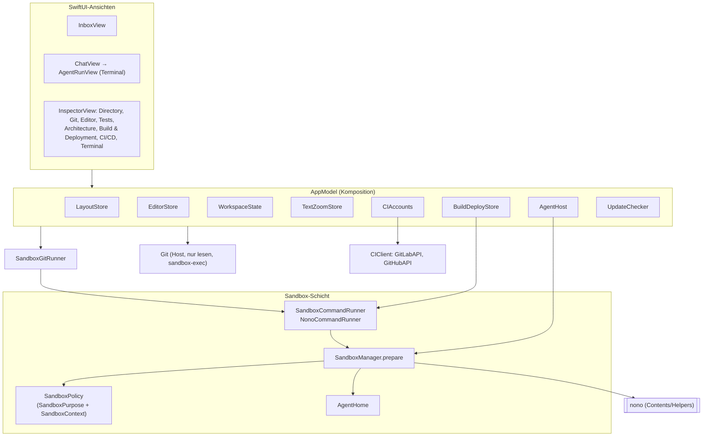
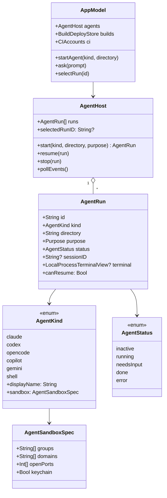
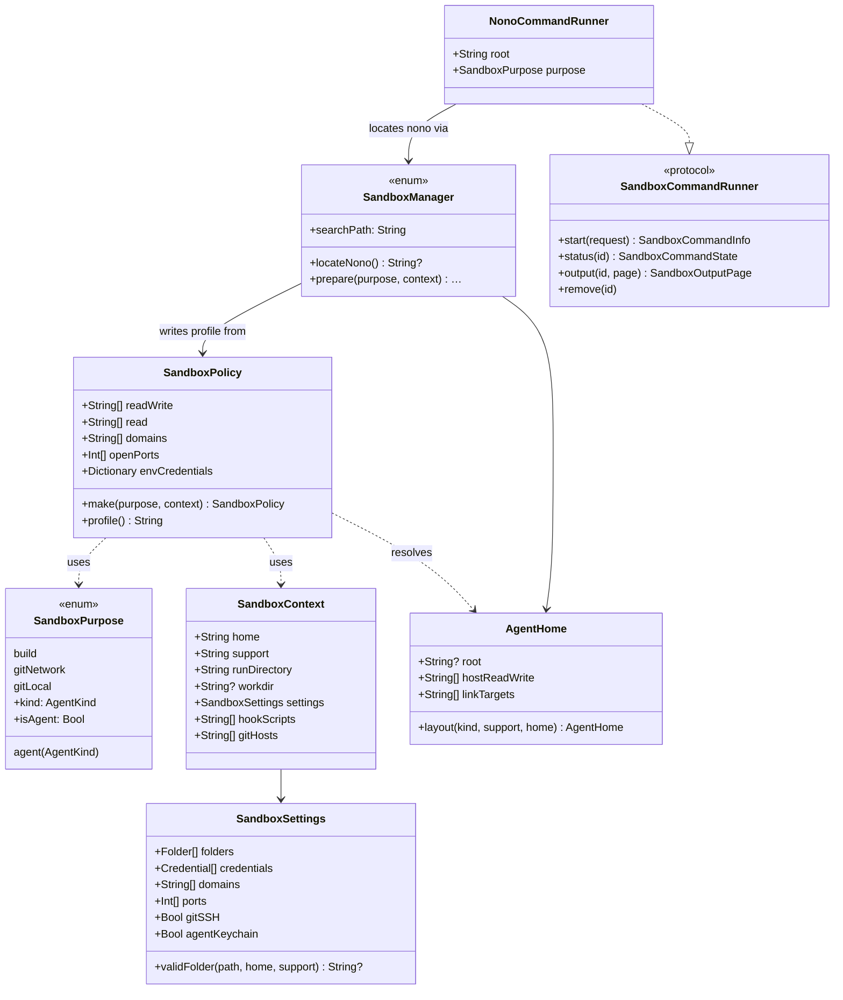
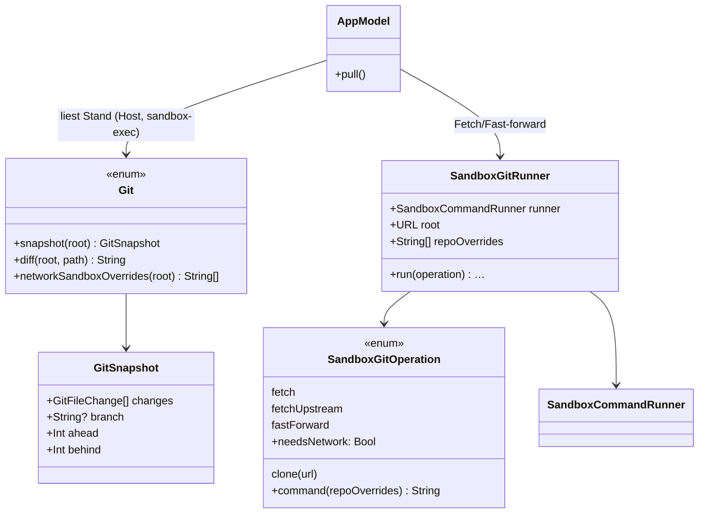
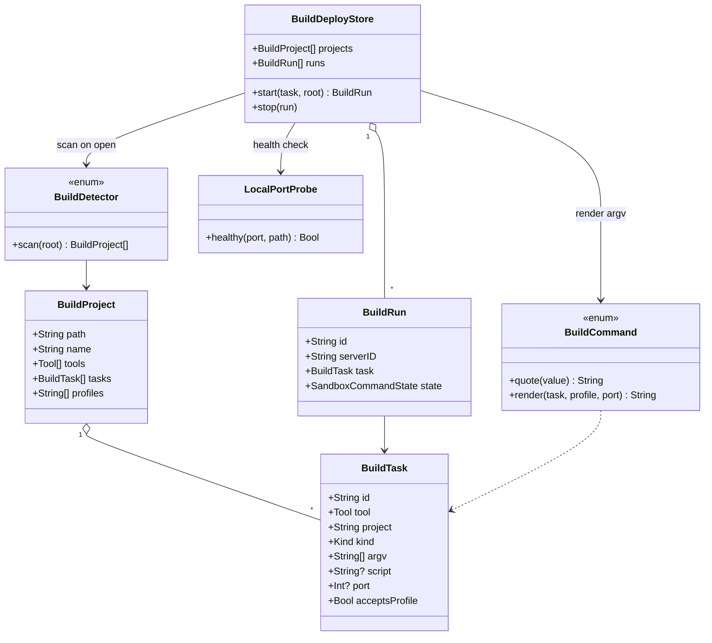
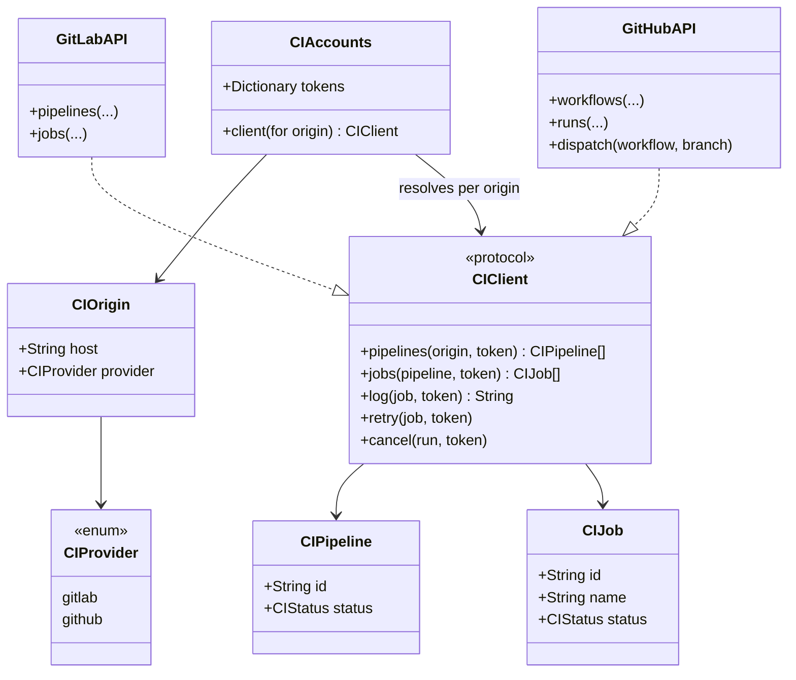

# Architektur

Stand v0.4.3. Hearth ist eine SwiftUI-App ohne eigenen Agenten: Sie startet die
Agent-CLIs der Nutzer in einer nono-Sandbox und zeigt drumherum Inbox, Editor,
Git, Tests, Build & Deployment und CI.

## Überblick

## Bausteine

| Bereich | Typen | Aufgabe |
|---|---|---|
| Zustand | `AppModel` | Komposition und Auswahl: Die gewählte Agenten-Sitzung bestimmt den Arbeitsordner (`workspaceRoot`) und damit Inspector, Editor-Tabs und Build & Deployment. Startet Agenten, leitet „Auftrag an den Agenten“ ins Terminal, hält die privaten `NonoCommandRunner` (ein Runner je Ordner + Zweck). |
| | `LayoutStore` | Bereiche, Splits, eigene Fenster, Maximieren; gespeichert in `UIStateStore`. |
| | `EditorStore`, `EditorGroup` | Editoren pro Preview-Bereich, Tabs, ungespeicherte Dokumente, Navigation, „Gehe zu Definition“, Tabs pro Sitzung. |
| | `WorkspaceState` | Git-Stand, Verzeichnisbaum, Revision (lädt Inspector-Tabs neu, wenn ein Agent Dateien ändert). |
| | `TextZoomStore`, `CIAccounts` | Schriftgröße pro Bereich; CI-Tokens pro bestätigtem Origin (GitLab und GitHub getrennt). |
| | `AppLanguage` | Sprache der App (Englisch/Deutsch); schreibt `AppleLanguages`, wirkt nach Neustart. |
| Agenten | `AgentKind` | Katalog: Programm, Login, Status-Quelle, API-Hosts, Sandbox-Spezifikation (`AgentSandboxSpec`). |
| | `AgentHost`, `AgentRun` | Start, Fortsetzen, Stoppen, Status aus `events.jsonl` (Claude-Hooks, Codex-`notify`), Benachrichtigungen, `runs.json`. |
| Sandbox | `SandboxPurpose` | Wofür eine Sandbox ist: `.agent(kind)`, `.build`, `.gitNetwork`, `.gitLocal`. |
| | `SandboxPolicy` | Einzige Quelle aller Rechte: aus Zweck und `SandboxContext` (Home, Arbeitsordner, Einstellungen) wird das nono-Profil. Rein, ohne Dateizugriffe, daher als Golden-Datei testbar. Erlaubt iCloud Drive, iCloud-„Documents“-Ordner und `~/Library/CloudStorage` (Dropbox, OneDrive, Google Drive) als Arbeitsordner; der Rest von `~/Library` bleibt gesperrt. |
| | `AgentHome` | Eigener Konfigurationsordner je Agent mit nur-lesenden Links auf die eigene Konfiguration; Schreibsperren für Agenten ohne Ordner-Variable. |
| | `SandboxManager` | Findet nono und die CLI, prüft den Arbeitsordner, schreibt Profil und Status-Hooks, baut Befehlszeile und Umgebung. |
| | `SandboxCommandRunner`, `NonoCommandRunner` | Typisierte Schnittstelle für Befehle in der Sandbox (Start, Status, Ausgabe-Seiten, Entfernen); jeder Befehl in einer eigenen nono-Sandbox. |
| Git | `Git` | Lesende Host-Abfragen und lokale Änderungen unter `sandbox-exec` ohne Netz und ohne Helfer. |
| | `SandboxGitOperation`, `SandboxGitRunner` | Fetch/Clone in `.gitNetwork`, Fast-forward in `.gitLocal`; Repo-Helfer neutralisiert. |
| Build | `BuildDetector`, `BuildTask`, `BuildCommand`, `BuildDeployStore` | Aufgaben aus Projektdateien (Maven, Gradle, npm, Go, Make, eigene) erkennen, sicher gequotete Befehle bauen, ausführen, Health-Checks über `SandboxCommandRunner`. Maven/Gradle/npm bekommen einen eigenen Cache unter `~/Library/Caches/Hearth/`; Java-Programme (auch Spring Boot mit Vaadin) ein eigenes Home dort, Dev-Server dürfen lokale Hilfsprozesse (z. B. Vite) erreichen. |
| CI/CD | `CIClient` (`GitLabAPI`, `GitHubAPI`), `CIAccounts` | GitLab-Pipelines und GitHub Actions (github.com und Enterprise) über ein gemeinsames Protokoll: Läufe, Jobs als Diagramm oder Liste, Logs, Retry/Cancel, `workflow_dispatch`. Tokens pro bestätigtem Origin. |
| Sonstiges | `TestReports`, `MermaidScanner`, `SymbolFinder`, `AppUpdates` | Testberichte, Architekturdiagramme, Definitionen, Updates. |

## Datenablage

| Ort | Inhalt |
|---|---|
| `~/Library/Application Support/Hearth/settings.json` | Sandbox-Regeln der Nutzer (Domains, Ports, Ordner, Projekte, Credentials-Metadaten) |
| `…/Hearth/runs.json`, `…/Hearth/runs/<id>/` | Sitzungen; je Sitzung nono-Profil, Log, Status-Ereignisse, Hook-Skripte |
| `…/Hearth/agents/<agent>/` | Hearths Konfigurationsordner der Agenten (Login, Verlauf, Einstellungen) |
| `UserDefaults` (`ui.*`) | Layout, Editor-Tabs (auch pro Sitzung), Schriftgrößen, Sprache, Update-Einstellungen |
| Schlüsselbund | `nono` / `hearth.<name>`: Credentials für den nono-Proxy; `hearth-gitlab`: CI-Tokens (GitLab, GitHub) |

## Abläufe

**Agent starten:** `AppModel.startAgent` → `AgentHost.start` → `SandboxManager.prepare(.agent(kind))`
(Arbeitsordner prüfen, `AgentHome.prepare`, Profil aus `SandboxPolicy`, Hooks) → SwiftTerm startet
`nono run --profile … -- <cli>`. Hooks schreiben in `events.jsonl`, `AgentHost` liest alle 0,5 s.

**Pull:** `AppModel.pull` → `SandboxGitRunner(.fetchUpstream)` in `.gitNetwork` → bei Erfolg
`SandboxGitRunner(.fastForward)` in `.gitLocal`.

**Build-Aufgabe:** `BuildDeployStore.start` → `NonoCommandRunner(.build).start` → Ausgabe seitenweise,
Health-Check vom Mac aus über `LocalPortProbe`. Maven/Gradle greifen über den nono-Proxy der Sandbox
(`BuildCommand.proxySetup`) statt über `HTTP(S)_PROXY`, das Java ignoriert.

**CI/CD laden:** `CIAccounts` löst aus dem Git-Remote Anbieter und Origin auf → passendes `CIClient`
(`GitLabAPI` oder `GitHubAPI`) liest Pipelines/Workflows, Jobs und Logs über das gemeinsame Protokoll.

## Klassendiagramme

### Agenten: Start, Sitzung, Katalog

### Sandbox-Schicht: Rechte, Profile, Befehle

### Git: Host-Lesezugriffe und Sandbox-Operationen

### Build & Deployment

### CI/CD: GitLab und GitHub über ein Protokoll

## Tests und Auslieferung

- `scripts/test.sh` (swift-testing, auch ohne Xcode). Golden-Profile in `Tests/HearthTests/Golden`,
  Live-Tests gegen echtes nono, Fakes für die Sandbox-Schnittstelle (`FakeCommandRunner`).
- `.github/workflows/ci.yml`: Build und Tests bei jedem Push/PR, App-Bundle als Artefakt,
  Release bei Versions-Tag. `scripts/release.sh` setzt Changelog und Tag.
